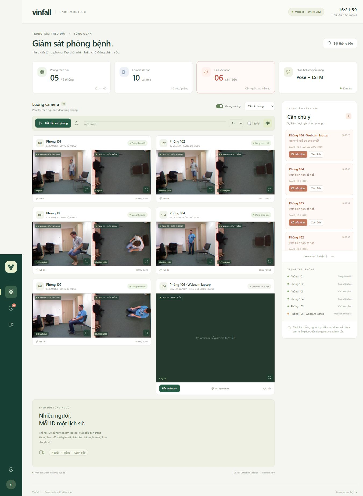

# VinFall Care Monitor

Dashboard phát hiện **nghi té ngã tại 5 phòng video (101–105) và phòng 106 dùng webcam laptop**, theo dõi nhiều người trong từng camera. Chạy local bằng Python/FastAPI; giao diện HTML/CSS/JavaScript không cần Node hay dịch vụ cloud.



## Chạy bản đã chuẩn bị

Từ thư mục `VinFall` trong PowerShell:

```powershell
.\.venv\Scripts\python.exe -m vinfall
```

Mở **http://127.0.0.1:8000**, bấm **Bắt đầu mô phỏng**. Có thể chạy bằng `./run.ps1`. Dừng máy chủ bằng Ctrl+C.

Tại **phòng 106**, bấm **Bật webcam**, cho phép trình duyệt sử dụng camera. Camera chạy độc lập với nút phát/tạm dừng video. Không cần train lại để dùng tính năng này: ứng dụng dùng các trọng số YOLO và LSTM đã có.

Bản trong workspace đã có 100 video, trọng số YOLO, LSTM được huấn luyện và cache khung xương. Dataset, model, cache và nhật ký được `.gitignore` để không đưa file lớn vào Git.

## Thiết lập lại sau khi clone

Khuyến nghị Python 3.11–3.13, có mạng lúc cài và tải dữ liệu:

```powershell
python -m venv .venv
.\.venv\Scripts\python.exe -m pip install -e .
.\.venv\Scripts\python.exe scripts/download_model.py
.\.venv\Scripts\python.exe scripts/download_data.py --full
.\.venv\Scripts\python.exe scripts/train_model.py
.\.venv\Scripts\python.exe scripts/evaluate_demo.py
.\.venv\Scripts\python.exe -m vinfall
```

Hoặc chạy `./setup.ps1` để thực hiện các bước cài đặt, tải dữ liệu và huấn luyện. Sau lần đầu, inference và phát lại không cần Internet. Máy không cần GPU. Lần trích xuất pose đầu tiên lâu hơn các lần dùng cache.

## Giao diện

- **Giám sát:** tối đa 10 video tại phòng 101–105, mỗi phòng hiển thị đúng 1 hoặc 2 camera theo nguồn có sẵn; vẽ khung xương; phóng to từng camera; phát/tạm dừng/phát lại; tốc độ 0.5×/1×/2× và lặp lại.
- **Webcam laptop:** phòng 106 có nút bật/tắt, hiển thị toàn bộ RGB, khung và ID từng người. Có thể chọn thiết bị ở trang nguồn video sau khi cấp quyền. Dừng webcam trước khi đổi thiết bị. Dùng `localhost`/`127.0.0.1` hoặc HTTPS để trình duyệt cấp quyền camera.
- **Cảnh báo:** popup ghi phòng, âm báo sau khi người dùng tương tác; danh sách sự kiện; ảnh từ các camera có sẵn lúc phát hiện; nút xác nhận đã tiếp nhận. Bật thông báo trình duyệt bằng nút **Bật thông báo** nếu muốn nhận thông báo hệ thống.
- **Nhật ký:** lưu SQLite, tồn tại sau khi restart; xuất CSV UTF-8, kèm phòng, camera, thời gian và trạng thái xác nhận.
- **Nguồn video & mô hình:** chọn trong 30 bộ té ngã hai camera và 40 bộ sinh hoạt một camera, lưu cấu hình local; xem báo cáo mô hình. Đổi nguồn sẽ tạm dừng và đưa phiên về đầu để đồng bộ.

### Nguồn chỉ có một camera

Nguồn được nhận diện theo tên file trong `data/urfd/`:

- Chỉ có `adl-01-cam0.mp4` → hiển thị một camera 0.
- Chỉ có `example-cam1.mp4` → hiển thị một camera 1, giữ đúng ID camera khi phát và lưu ảnh.
- Có cả `example-cam0.mp4` và `example-cam1.mp4` → hiển thị hai camera.

Thiếu một góc quay không còn gây lỗi hoặc tạo ô video chờ vô hạn. Nếu cả dataset chỉ có một video, ứng dụng gán video đó vào một phòng; các phòng còn lại hiện **Chưa có video**, không lặp cùng video sang các phòng khác. Số phòng và camera trên dashboard được tính theo dữ liệu thực. Khi đổi nguồn giữa một và hai camera, UI thêm/bỏ khung tương ứng. Nhật ký lưu số camera của từng sự kiện, nên ảnh cảnh báo cũ không phụ thuộc vào nguồn hiện tại của phòng.

Một camera có thể phát cảnh báo cho phòng. Các phát hiện cùng phòng trong cửa sổ 3 giây được gộp vào một sự kiện, giữ đầy đủ camera, ID và loại phát hiện trong `observations`. Phát hiện về sau vẫn có thể tạo sự kiện mới; không khóa cả phòng sau cảnh báo đầu tiên. Xác nhận chỉ ghi nhận người trực tiếp nhận. Restart đưa các video về đầu và giữ nhật ký, không đặt lại webcam. Năm phòng video bắt đầu cách nhau 2 giây để tiện trình diễn.

### Nhiều người và mất dấu do che khuất

- YOLO giữ **tất cả người được phát hiện**, không chỉ người có bounding box lớn nhất. Tracker ghép toàn cục theo vị trí dự đoán, độ chồng lấp và histogram màu quần áo. Mỗi ID có lịch sử pose 10 Hz, LSTM và bộ xác nhận té ngã riêng. Một người té vẫn được phân tích khi người khác đang đứng hoặc có khung lớn hơn.
- ID chỉ có ý nghĩa **trong camera và phiên hiện tại**, không phải danh tính bệnh nhân hoặc ID dùng chung giữa hai camera. Theo dõi ngắn hạn có thể đổi ID khi giao nhau, bị che lâu hoặc trang phục giống nhau.
- Mặc định: đã quan sát người tối thiểu **1 giây** và ít nhất 3 lần, sau đó mất dấu **8 giây** liên tục bên trong khung hình → cảnh báo **Nghi té ngã do che khuất**. Người xuất hiện lại trước ngưỡng sẽ hủy đếm mất dấu. Một khoảng mất dấu chỉ báo một lần; xuất hiện lại rồi mất dấu lần nữa có thể tạo sự kiện mới.
- Đi ra qua viền ảnh (mặc định 8%) hoặc vùng cửa được đánh dấu sẽ không báo che khuất. Trong **Nguồn video & mô hình → Webcam & cảnh báo mất dấu**, chỉnh thời gian 2–120 giây, thời gian quan sát và viền ra/vào. Bấm **Đánh dấu cửa ra/vào**, kéo hình chữ nhật trên ảnh webcam bao gồm vị trí bàn chân ở cửa. Vùng cửa tùy chọn chỉ áp dụng cho webcam; ngưỡng thời gian và viền áp dụng cho cả video. Cấu hình lưu trong `runtime/tracking.json`.
- Cảnh báo lưu loại `fall` hoặc `occlusion`, phòng, camera, ID, thời điểm cuối nhìn thấy và vị trí cuối. Ảnh cảnh báo gồm ảnh tại lúc phát hiện; cảnh báo che khuất có thêm ảnh cuối cùng còn thấy người đó.

Đây là **suy luận từ mất dấu**, không thể xác nhận một người đang té phía sau vật cản. Cửa chưa đánh dấu, người cúi/khuất hoàn toàn hoặc lỗi nhận diện có thể tạo cảnh báo nhầm. Nhận biết đi ra cũng là quy tắc hình học, không chứng minh được người còn ở trong phòng. Cần bố trí vùng cửa và kiểm thử theo góc quay thực tế.

Webcam gửi JPEG về backend cục bộ, xử lý tuần tự với mục tiêu tối đa 10 mẫu/giây, không tích hàng đợi. Giữ tab camera mở khi giám sát. Mất luồng quá 2 giây sẽ đặt lại tracking khi có ảnh trở lại; quá 5 giây sẽ báo lỗi camera và kết thúc phiên. Lỗi luồng không được tính là một người mất dấu. Đóng tab hoặc bấm dừng sẽ dừng camera; chỉ lưu ảnh khi có sự kiện, không ghi liên tục thành video.

## Dữ liệu đã tải

Nguồn chính thức: [UR Fall Detection Dataset, University of Rzeszów](https://fenix.ur.edu.pl/~mkepski/ds/uf.html).

- 30 tình huống té ngã × 2 camera = **60 MP4**.
- 40 video sinh hoạt thường ngày, chỉ có camera 0 = **40 MP4**.
- 2 CSV nhãn tư thế chính thức; tổng tải **102 file, khoảng 116 MiB**.
- Manifest URL, kích thước, SHA-256: `docs/dataset_manifest.json` và bản local trong `data/urfd/manifest.json`.
- Năm bộ mặc định: `fall-01`, `fall-03`, `fall-06`, `fall-09`, `fall-10`.

Video xem trước của URFD ghép ảnh độ sâu bên trái và RGB bên phải. Pose chỉ được chạy trên nửa RGB, còn trình duyệt hiển thị đúng vùng này. Hai MP4 của cùng bộ dùng chung đồng hồ phát lại, giữ nguyên offset trong video gốc; chưa hiệu chỉnh sai lệch thời gian vật lý giữa cảm biến. Phòng 101–105 là nhãn mô phỏng, không phải thông tin phòng hay bệnh nhân gốc. Các ca té ngã được dàn dựng, không phải video té ngã của bệnh nhân cao tuổi.

## Mô hình và xử lý cảnh báo

```text
Video RGB mỗi phòng / webcam trực tiếp
    → YOLOv8n Pose (17 điểm khớp, lấy mẫu 10 Hz)
    → Ghép theo ID từng người trong camera
    → Đặc trưng pose 57 chiều + LSTM riêng từng ID (16 mẫu)
    → Xác nhận chuyển động / quy tắc mất dấu bên trong khung
    → Gộp theo phòng trong cửa sổ 3 giây
    → WebSocket → dashboard, âm thanh, thông báo / webhook tùy chọn
```

`scripts/train_model.py` huấn luyện LSTM bằng nhãn tư thế của URFD, chọn checkpoint và ngưỡng trên tập validation. Hai góc của một tình huống luôn ở cùng một tập. **Năm bộ demo được loại khỏi tập train và validation của LSTM.** Nhãn camera 1 được đối chiếu theo timeline 30 Hz của camera 0; đây là giả định của prototype, không phải nhãn camera 1 được xác minh thủ công.

LSTM phân loại tư thế trên sàn; bộ xác nhận yêu cầu đã quan sát tư thế đứng, chuyển động hạ thân/đổi hướng và vị trí hông thấp hơn tham chiếu trước đó. Điểm mô hình phải vượt ngưỡng đủ **0.3 giây quan sát hợp lệ**. Mất pose ngắn sẽ tạm dừng tích lũy; khoảng bị che không được cộng vào thời gian xác nhận. Mất pose quá 0.35 giây sẽ xóa bằng chứng chuyển động. Người đã nằm sẵn khi xuất hiện sẽ không tạo sự kiện ngã. Cảnh báo đã phát được giữ đến lượt phát mới; xác nhận chỉ ghi nhận người trực đã tiếp nhận.

Cache chỉ lưu kết quả **YOLO thực sự suy luận từ ảnh**, gồm mọi người trong từng khung; cache mới tách riêng khỏi cache một người dùng huấn luyện. Khi chạy lại, backend vẫn thực hiện tracking, LSTM và bộ xác nhận theo thời gian video. Backend không đọc nhãn CSV, tên lớp `fall/adl` hay bảng thời điểm định sẵn để phát cảnh báo. Video dùng trình phát native của browser; webcam suy luận trực tiếp và không cắt nửa ảnh. Chưa có kết nối RTSP. Lần đầu mở mỗi nguồn sau nâng cấp sẽ trích xuất lại cache nhiều người, không huấn luyện lại model.

## Kiểm tra đã thực hiện

```powershell
.\.venv\Scripts\python.exe -m pytest -q --basetemp runtime/test-tmp
.\.venv\Scripts\python.exe scripts/evaluate_demo.py
.\.venv\Scripts\python.exe scripts/evaluate_multi_person.py
```

- Unit/integration tests bao gồm: nhiều người và thứ tự detection thay đổi, người nhỏ té trong khi người lớn đứng, mất dấu khi người khác vẫn hiện diện, đi ra qua viền/vùng cửa, xuất hiện ngắn, tái xuất hiện, phiên webcam, JPEG/API, mất luồng, ảnh cuối thấy người, nhiều cảnh báo về sau, cấu hình và nâng cấp DB cũ. Lệnh pytest in tổng số test hiện tại.
- Phát lại phát hiện **5/5 bộ demo**; không phát cảnh báo trong **5 video sinh hoạt đối chiếu**. Chi tiết từng video: `docs/demo_evaluation.json`. Bộ xác nhận đã được điều chỉnh dựa trên các lượt demo này, nên kết quả này **không phải kiểm định độc lập**.
- Báo cáo LSTM: `docs/training_report.json`; Precision khoảng **77.2%**, Recall **88.4%**, F1 **82.4%**, tính theo cửa sổ tư thế trong tập kiểm tra. Đây không phải độ chính xác cảnh báo theo sự kiện. Tách theo tình huống, chưa tách độc lập theo người tham gia.
- Cả hai camera đều được phân tích và hiển thị. Trong năm bộ demo, cảnh báo cuối cùng đều được phát từ camera ngang; camera trần thường thiếu keypoint và có nhiều dự đoán chưa ổn định.
- Kiểm tra tổng hợp với YOLO/LSTM thật: ghép hai cảnh URFD cạnh nhau, một người té và một người đứng → báo đúng người té tại 4.3 giây; một người bị xóa khỏi ảnh trong khi người còn lại đứng → cảnh báo che khuất sau 8 giây. Chi tiết `docs/multi_person_diagnostic.json`. Đây là **khung hình ghép và biến mất được mô phỏng**, không phải bộ đánh giá nhiều người/che khuất ngoài thực tế.
- Kiểm tra đường webcam HTTP/JPEG: gửi 117 ảnh mẫu qua API thật, nhận cảnh báo phòng 106 sau khoảng 8.07 giây mất dấu và tải được cả ảnh hiện tại lẫn ảnh cuối thấy người. Báo cáo `docs/webcam_api_diagnostic.json`; ảnh UI `docs/occlusion-alert.png`. Dữ liệu đầu vào vẫn là khung hình ghép để chẩn đoán, không phải ca té ngã bị che khuất thực tế.

Prototype có thể bỏ sót té ngã hoặc báo nhầm khi đổi góc camera, thiếu sáng, bị che, có nhiều người hoặc hành vi khác dữ liệu huấn luyện. Cần dữ liệu đại diện cho người cao tuổi và đánh giá theo sự kiện/giờ giám sát trước khi triển khai chăm sóc thực tế.

## Gửi cảnh báo sang hệ thống khác (tùy chọn)

Không cần cấu hình để dùng cảnh báo trên dashboard. Nếu có HTTP endpoint nhận JSON, đặt biến môi trường trước khi chạy:

```powershell
$env:VINFALL_ALERT_WEBHOOK = 'https://your-server.example/fall-alerts'
.\.venv\Scripts\python.exe -m vinfall
```

Payload gồm `event` (`suspected_fall`/`suspected_occluded_fall`), `event_id`, `room_id`, `room_name`, `source`, `video_time`, `track_id`, `kind`, `details`, `message`. Webhook gửi một lần khi tạo sự kiện phòng; các quan sát gộp thêm được giữ trong SQLite và UI. Chạy ngoài luồng giám sát với timeout 5 giây; khi gửi lỗi, sự kiện vẫn tồn tại trong SQLite và UI báo trạng thái lỗi. Prototype chưa có hàng đợi retry. Không có email/SMS được gửi mặc định.

## API truy vấn nhật ký cảnh báo

`GET /api/alerts` truy vấn toàn bộ nhật ký SQLite, kể cả các sự kiện cũ ngoài 200 cảnh báo gần nhất trong snapshot dashboard.

Ví dụ: `/api/alerts?room_id=106&kind=occlusion&acknowledged=false&limit=50&offset=0`.

- `room_id`: lọc đúng ID phòng; bỏ qua để lấy tất cả phòng.
- `kind`: `fall` hoặc `occlusion`; bỏ qua để lấy cả hai.
- `acknowledged`: `true` (đã tiếp nhận) hoặc `false` (chờ xác nhận); bỏ qua để lấy cả hai.
- `limit`: số sự kiện mỗi trang, mặc định 50, từ 1 đến 200.
- `offset`: số sự kiện bỏ qua, mặc định 0, không âm.

Kết quả có dạng `{ "items": [...], "total": 123, "limit": 50, "offset": 0 }`. `total` là tổng số sự kiện khớp bộ lọc trước phân trang. Sự kiện sắp theo thời điểm mới nhất, dùng ID để giữ thứ tự ổn định khi trùng thời điểm. Mỗi phần tử giữ đầy đủ camera, observations và thời điểm tiếp nhận. Tham số không hợp lệ trả HTTP 422; phòng không có dữ liệu hoặc trang vượt cuối trả `items: []`. Khi có sự kiện mới hoặc thay đổi trạng thái giữa hai lần gọi, vị trí trang có thể dịch chuyển.

## Cấu trúc

```text
src/vinfall/       Backend, LSTM, bộ xác nhận và giao diện static
scripts/           Tải model/data, trích xuất pose, huấn luyện, phát lại đánh giá
tests/             Kiểm thử logic, gộp cảnh báo, replay và API
docs/              Manifest dữ liệu, báo cáo huấn luyện và kiểm tra demo
data/urfd/         Video và nhãn gốc (không commit)
data/cache/        Pose cache theo SHA-256 nội dung video (không commit)
models/            YOLO + LSTM (không commit)
runtime/           SQLite, cấu hình phòng, ảnh sự kiện (không commit)
```

Phương pháp pose theo chuỗi: [Lin et al., OpenPose + LSTM/GRU](https://www.mdpi.com/2076-3417/11/1/329). Pose estimator: [Ultralytics Pose](https://docs.ultralytics.com/tasks/pose/). Trọng số YOLO được tải từ release chính thức và kiểm tra SHA-256.
